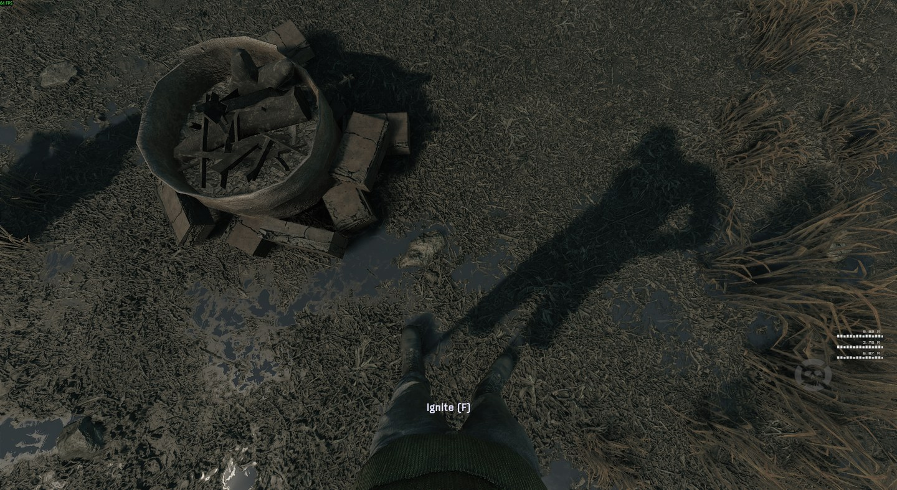

# Unholy's First-Person Body Fix Mod

Matches the default first-person body mesh to the unarmored actor rig. In Romeo this corrects the sweater model used for the visible legs and body shadow. Equipped outfits still use their own body visuals.

*Native Romeo screenshot at the Clear Sky base with the matched sweater rig.*

## Install

1. Download the ZIP for your setup from [Releases](https://github.com/noahcabral/unholys-first-person-body-fix-mod/releases).
2. In standalone Anomaly, extract the ZIP into the game folder so its `gamedata` folder merges with the game's. In GAMMA or Romeo, install it as a separate Mod Organizer 2 entry. Enable only one edition.
3. Restart the game and enable **First Person Body** in the modded engine options, or enter `g_legs 1` in the in-game console.

To uninstall, disable the entry in Mod Organizer 2 or remove `gamedata/configs/mod_system_zzzz_unholy_first_person_body.ltx`, then restart.

## Compatibility

| Setup | Edition | Verification |
| --- | --- | --- |
| Romeo with xrRazom and native first-person body support | Romeo | Tested in game against the unarmored sweater actor. |
| GAMMA with native first-person body support | Anomaly and GAMMA | Checked the effective local profile and the installed model. |
| Standalone Anomaly 1.5.3 with native first-person body support | Anomaly and GAMMA | Checked the stock configuration and packed model. |

The mod requires an engine with DLTX and native `g_legs`. For standalone Anomaly, use an engine such as [Demonized's Modded Exes](https://github.com/themrdemonized/xray-monolith) with both features. Anomaly and GAMMA already use the stock actor as their default fallback in the checked configurations. Their edition makes that default explicit.

Each edition is one LTX override and references a model already available in the game. Disable a previous version of this fix or any addon that also sets the default `[actor]` `legs_visual`. If another mod replaces the unarmored actor with a different rig, set `legs_visual` to that mod's matching mesh. The engine's outfit-specific settings still take priority. An older scripted visible-body addon may draw a second body if enabled alongside native `g_legs`.

## Source

[Anomaly and GAMMA override](anomaly-gamma/gamedata/configs/mod_system_zzzz_unholy_first_person_body.ltx) · [Romeo override](romeo/gamedata/configs/mod_system_zzzz_unholy_first_person_body.ltx)
