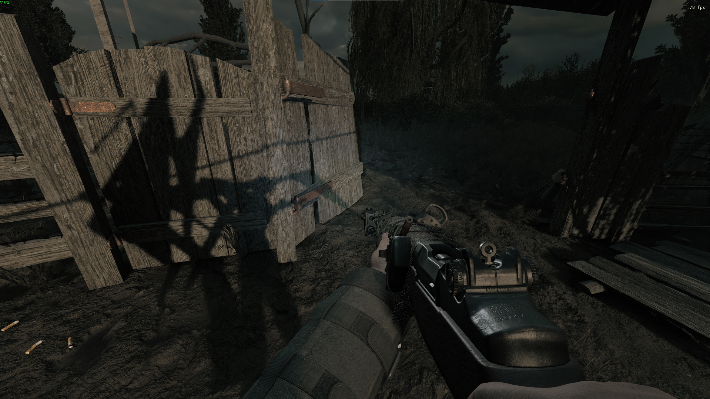
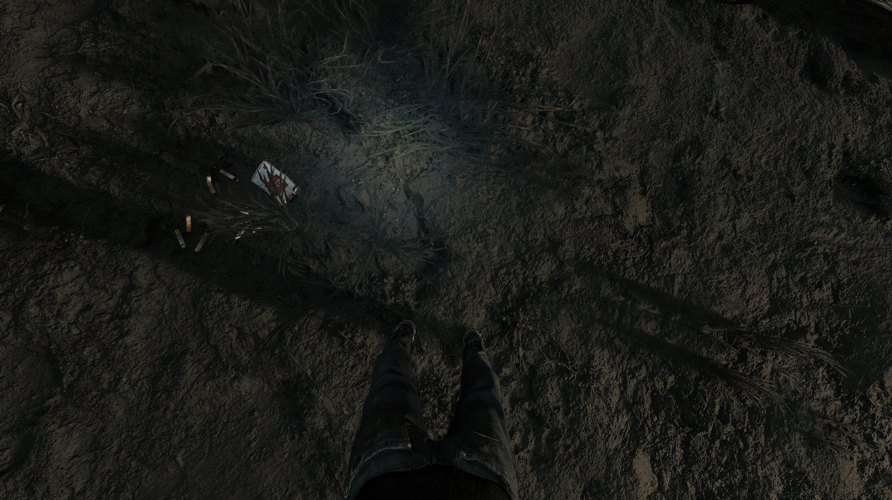

# Unholy's First-Person Body Fix Mod

Fixes the backward-facing first-person body and distorted shadow on the default unarmored character.

## What the mod fixes

*Distorted body shadow before the fix.*

*Backward-facing body before the fix.*

## After the fix

*Corrected body and shadow at the Clear Sky base in Romeo.*
